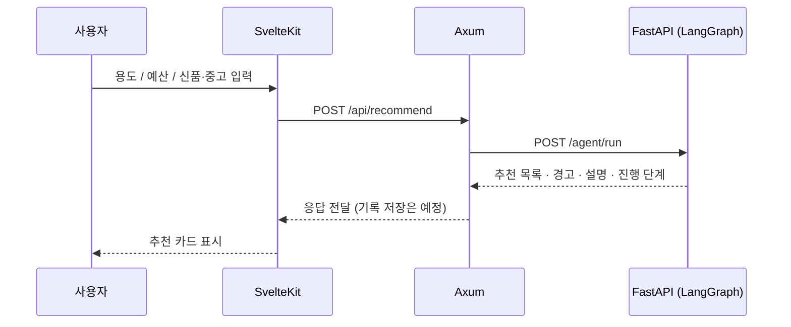
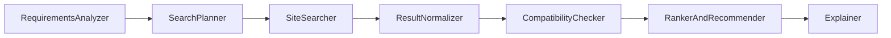

# PCForge

**용도와 예산, 선호 조건을 입력하면 AI 에이전트가 쇼핑몰과 중고 거래 사이트에서 PC 부품·완제품을 찾아 비교하고 추천해 주는 맞춤형 에이전트 사이트입니다.**

> 내 예산과 용도에 딱 맞는 PC 구성을 여러 쇼핑몰에서 한 번에 찾아주고, 비교와 추천까지 해주는 경험이 목표입니다.

| 항목 | 내용 |
|------|------|
| 유형 | 미니 프로젝트 (Vibe Coding 대상) |
| 기획서 버전 | v1.2 (2026-11-05) |
| 스택 | SvelteKit · Axum(Rust) · FastAPI · LangGraph · PostgreSQL |
| AI | LangChain / LangGraph, RAG, 로컬 LLM(Ollama / LM Studio) |

---

## 현재 상태

> **뼈대 단계입니다.** 세 서버와 DB가 연결되어 추천 요청이 끝까지 흐르지만, **추천 결과는 목업 데이터이고 실제 상품·가격이 아닙니다.**

| 기능 | 상태 |
|------|------|
| Axum → FastAPI 추천 요청 전달 | ✅ 동작 (curl로 확인) |
| SvelteKit 화면 → Axum 호출 | 🟡 페이지 응답과 CORS 설정만 확인, 브라우저에서 눌러 보지 않음 |
| LangGraph 7개 노드 실행 | ✅ 동작 (규칙 기반 임시 구현) |
| 요구사항 입력 폼, 추천 결과 카드 | 🟡 구현됨 · 타입 체크와 빌드 통과, 브라우저 동작은 미확인 |
| Streamlit MVP (노드별 진행 로그 + 결과) | 🟡 자동 테스트로 예외 없음만 확인, 실제 화면은 미확인 |
| PostgreSQL 스키마 (5개 테이블) | ✅ 마이그레이션 작성 |
| 사이트 검색 | 🟡 목업 데이터 |
| 호환성 검증 | 🟡 "미구현" 경고만 출력 |
| 로컬 LLM(Ollama) 연동 | ⬜ 미구현 |
| RAG (벡터 스토어, 임베딩) | ⬜ 미구현 |
| 로그인 / 회원가입 | ⬜ 미구현 (`501` 응답) |
| 검색·추천 기록 저장과 조회 | ⬜ 미구현 (`501` 응답) |
| 신품·중고 실제 사이트 검색 | ⬜ 미구현 |

표기: ✅ 직접 실행해 확인 · 🟡 구현했지만 일부만 확인 · ⬜ 미구현

단계별 계획은 [로드맵](#로드맵)을 참고하세요.

---

## 아키텍처

```
┌─────────────┐     ┌──────────────────┐     ┌─────────────────┐
│  SvelteKit  │────▶│      Axum        │────▶│    FastAPI      │
│  :5173      │◀────│  :3000           │◀────│  :8000          │
└─────────────┘     └──────────────────┘     └─────────────────┘
                            │                         │
                            ▼                         ▼
                     ┌─────────────┐          ┌──────────────┐
                     │ PostgreSQL  │          │ Local LLM    │
                     │ :5432       │          │ + RAG Store  │
                     └─────────────┘          └──────────────┘
```

| 계층 | 맡는 일 | 맡지 않는 일 |
|------|---------|--------------|
| **SvelteKit** | UI, 폼, 결과 카드·비교, 화면 상태 | DB 접근, AI 서버 직접 호출 |
| **Axum** | API 게이트웨이, 인증, DB, AI 서버 호출, 캐시, 에러 처리 | 에이전트·LLM 로직 |
| **FastAPI** | LangGraph 에이전트, RAG, 로컬 LLM, 검색 도구 | 사용자 인증, 기록 저장 |

역할 분담은 예외 없이 지킵니다. 자세한 내용은 [아키텍처 문서](Docs/Architecture/pcforge_architecture.md)를 참고하세요.

### 추천 요청 흐름



### LangGraph 에이전트



| 노드 | 역할 | 현재 구현 |
|------|------|-----------|
| RequirementsAnalyzer | 입력 파싱·구조화 | 입력 확인만 |
| SearchPlanner | 사이트별 검색 전략 | 신품·중고 조건에 따른 사이트 목록 |
| SiteSearcher | 사이트 검색 도구 호출 | 목업 상품 반환 |
| ResultNormalizer | 정규화, 중복 제거 | 사이트+상품명 기준 중복 제거 |
| CompatibilityChecker | RAG + 룰 호환성 검증 | 미구현 경고 |
| RankerAndRecommender | 점수화, 추천 | 예산 이하 상품을 가격 기준 정렬 |
| Explainer | 설명, 트레이드오프 | 고정 문장 |

---

## 폴더 구조

```
PCForge/
├── frontend/          SvelteKit (TypeScript)
├── backend/           Axum (Rust) + DB 마이그레이션
├── ai-server/         FastAPI + LangGraph + Streamlit
├── Docs/              기획·아키텍처·가이드·검증·커밋 기록
├── docker-compose.yml PostgreSQL
├── AGENTS.md          에이전트 공통 규칙 (SSOT)
└── .Claude/ .Codex/ ... 에이전트별 안내 (AGENTS.md를 가리킴)
```

| 폴더 | 문서 |
|------|------|
| [frontend/](frontend/) | [frontend/README.md](frontend/README.md) |
| [backend/](backend/) | [backend/README.md](backend/README.md) |
| [ai-server/](ai-server/) | [ai-server/README.md](ai-server/README.md) |

---

## 시작하기

### 준비물

| 도구 | 확인한 버전 | 용도 |
|------|-------------|------|
| Node.js | 24.x | 프론트엔드 |
| Rust (cargo) | 1.98 | 백엔드 |
| Python | 3.10 | AI 서버 |
| Docker | 28.x | PostgreSQL |
| Ollama | 0.40 | 로컬 LLM (Phase 1에서 사용 예정, 현재는 불필요) |

### 1. 환경 변수

각 계층의 `.env.example`을 복사해 `.env`를 만듭니다. `.env`는 커밋하지 않습니다.

```bash
cp .env.example .env
cp backend/.env.example backend/.env
cp ai-server/.env.example ai-server/.env
cp frontend/.env.example frontend/.env
```

루트 `.env`의 `POSTGRES_PASSWORD`를 정하고, `backend/.env`의 `DATABASE_URL`에 **같은 비밀번호**를 넣습니다.

> **`DATABASE_URL`의 호스트는 `localhost`가 아니라 `127.0.0.1`로 적습니다.** Windows에서 `localhost`로 두면 백엔드가 DB에 연결하지 못하고 `/health`가 `database: down`을 반환했습니다. (`127.0.0.1`은 정상)

| 파일 | 변수 | 설명 | 기본값 |
|------|------|------|--------|
| `.env` | `POSTGRES_USER` / `POSTGRES_PASSWORD` / `POSTGRES_DB` | DB 컨테이너 계정 (필수, 비어 있으면 compose가 실패) | `pcforge` / `change-me` / `pcforge` |
| `.env` | `POSTGRES_PORT` | 호스트에 노출할 DB 포트 | `5432` |
| `backend/.env` | `DATABASE_URL` | DB 연결 문자열 (**필수**) | 예시 파일 참고 |
| `backend/.env` | `BACKEND_PORT` | 백엔드 포트 | `3000` |
| `backend/.env` | `AI_SERVER_URL` | FastAPI 주소 | `http://localhost:8000` |
| `backend/.env` | `FRONTEND_ORIGIN` | CORS 허용 출처 | `http://localhost:5173` |
| `frontend/.env` | `PUBLIC_API_BASE_URL` | Axum 주소 | `http://localhost:3000` |
| `ai-server/.env` | `OLLAMA_*`, `EMBEDDING_MODEL` | 아직 코드에서 읽지 않음 (Phase 1에서 연결) | - |

### 2. 데이터베이스

```bash
docker compose up -d
cargo install sqlx-cli --no-default-features --features postgres,rustls   # 최초 1회
cd backend && sqlx migrate run
```

DB 컨테이너는 `127.0.0.1`에만 열립니다. 이미 5432 포트를 쓰는 DB가 있다면 루트 `.env`의 `POSTGRES_PORT`와 `DATABASE_URL`의 포트를 함께 바꾸세요. 마이그레이션은 백엔드가 자동으로 적용하지 않으므로 DB를 새로 만들 때마다 `sqlx migrate run`을 실행합니다.

### 3. 서버 실행

터미널을 나눠서 실행합니다.

```bash
# AI 서버 (:8000)
cd ai-server
python -m venv .venv
.venv/Scripts/python -m pip install -r requirements.txt     # Linux/macOS: .venv/bin/python
.venv/Scripts/python -m uvicorn app.main:app --port 8000

# 백엔드 (:3000)
cd backend
cargo run

# 프론트엔드 (:5173)
cd frontend
npm install
npm run dev
```

브라우저에서 <http://localhost:5173> 을 열면 됩니다.

### 4. 동작 확인

```bash
curl localhost:8000/health        # {"status":"ok"}
curl localhost:3000/health        # {"database":"up","status":"ok"}

curl -X POST localhost:3000/api/recommend \
  -H 'content-type: application/json' \
  -d '{"purpose":"게이밍","budget_krw":250000,"condition":"used"}'
```

`/health`의 `database`가 `down`이면 DB가 꺼져 있거나 `DATABASE_URL`이 틀린 것입니다. 이때도 서버는 뜹니다.

### Streamlit으로 AI 로직만 확인

백엔드와 DB 없이 에이전트만 단독으로 확인할 수 있습니다.

```bash
cd ai-server
.venv/Scripts/python -m streamlit run streamlit_app.py
```

---

## API 요약

자세한 요청·응답 예시는 [API 레퍼런스](Docs/guidance/api-reference.md)를 참고하세요.

| 서버 | 메서드·경로 | 설명 | 상태 |
|------|-------------|------|------|
| Axum | `GET /health` | 서버·DB 상태 | ✅ |
| Axum | `POST /api/recommend` | 요구사항을 AI 서버로 전달 | ✅ |
| Axum | `GET /api/sessions` | 내 검색 기록 | `501` |
| Axum | `POST /api/auth/login` | 로그인 | `501` |
| FastAPI | `GET /health` | 서버 상태 | ✅ |
| FastAPI | `POST /agent/run` | LangGraph 에이전트 실행 | ✅ |

오류 응답: 입력이 잘못되면 `422`, AI 서버에 닿지 못하면 `502`, 미구현 API는 `501`입니다.

---

## 데이터 모델

[0001_init.sql](backend/migrations/0001_init.sql)에 정의되어 있습니다.

| 테이블 | 용도 |
|--------|------|
| `users` | 사용자, 선호도 |
| `search_sessions` | 검색 요청과 요구사항 |
| `recommendations` | 세션별 추천 결과와 근거 |
| `product_cache` | 사이트별 상품 캐시 |
| `compatibility_rules` | 룰 기반 호환성 데이터 |

---

## 로드맵

| 단계 | 내용 | 진행 |
|------|------|------|
| Phase 1 · AI MVP | LangGraph 뼈대 ✅ · Ollama 연동 ⬜ · RAG ⬜ · Streamlit 데모 🟡 (목업, 화면 미확인) | 진행 중 |
| Phase 2 · 메인 백엔드 | Axum 뼈대 ✅ · DB 스키마 ✅ · 인증 ⬜ · 기록 저장 ⬜ | 진행 중 |
| Phase 3 · 프론트엔드 | 폼·결과 카드 🟡 · 로그인 ⬜ · 기록 대시보드 ⬜ · 비교 뷰 ⬜ | 진행 중 |
| Phase 4 · 고도화 | 실제 사이트 검색 · RAG 데이터 보강 · 프롬프트 튜닝 · UI 개선 | 예정 |

성공 기준 체크리스트는 [검증 문서](Docs/vaildates/skeleton-validation.md)에서 관리합니다.

---

## 문서

| 문서 | 내용 |
|------|------|
| [AGENTS.md](AGENTS.md) | 에이전트 공통 규칙 (작업 전 필독) |
| [기획서 v1.2](Docs/plan/PCForge_기획서_v1.2.md) | 목표, 범위, 기능 상세 |
| [인수인계](Docs/plan/PCForge_인수인계.md) | 상세 규칙과 인수인계 원본 |
| [아키텍처](Docs/Architecture/pcforge_architecture.md) | 계층, 흐름, 구현 현황 |
| [로컬 환경 가이드](Docs/guidance/local-setup.md) | 설치·실행·문제 해결 |
| [API 레퍼런스](Docs/guidance/api-reference.md) | 엔드포인트와 응답 예시 |
| [검증 기록](Docs/vaildates/skeleton-validation.md) | 확인한 것과 확인하지 못한 것 |
| [Docs 목차](Docs/README.md) | 문서 폴더별 용도와 위치 |
| [커밋 기록](Docs/branchs/commits/) | 커밋·병합 기록 ([작성법](Docs/branchs/README.md)) |

---

## 개발 규칙

규칙의 원본은 [인수인계 문서](Docs/plan/PCForge_인수인계.md)이고, 아래는 핵심 요약입니다.

- **커밋 메시지:** `type(scope): 한국어 요약` (type·scope는 영어). 예: `feat(frontend): 요구사항 입력 폼 추가`
- **커밋 기록:** 커밋마다 `Docs/branchs/commits/`(필수 하위 폴더)에 기록 파일을 함께 커밋합니다. 이름 규칙과 항목은 [작성법](Docs/branchs/README.md)을 따릅니다.
- **브랜치:** `feature/*`에서만 작업하고, 영역별 고정 브랜치를 재사용합니다. (현재 `repo-setup`, `docs`, `backend`, `ai-server`, `frontend`)
- **병합:** 모든 커밋이 끝난 뒤 마지막에 한 번만 `--no-ff`로 `develop` → `main` 순서로 병합합니다. 지시 없이는 병합·푸시하지 않습니다.

---

## 주의사항

- **목업 데이터:** 현재 추천 결과의 상품명에는 `[목업]`이 붙어 있으며 실제 상품·가격이 아닙니다.
- **중고 거래:** 사기나 상태 불일치 위험이 있으므로 실제 연동 시 추천에 주의 문구를 포함합니다.
- **크롤링:** 사이트 연동 시 각 사이트의 이용약관과 robots 기준을 지키고, 요청량을 제한하며 캐시를 활용합니다. 초기에는 목업이나 공개 검색 결과로 시작합니다.
- **비밀 정보:** API 키, DB 연결 문자열, 비밀번호는 커밋하지 않습니다. ([SECURITY.md](SECURITY.md))

## 라이선스

[MIT](LICENSE)
