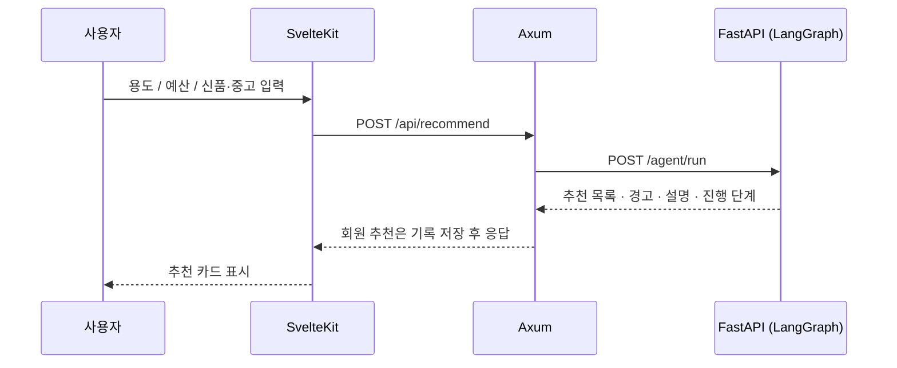
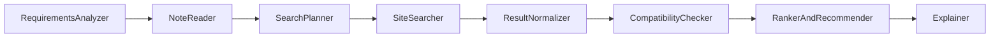

# PCForge

**용도와 예산, 선호 조건을 입력하면 AI 에이전트가 쇼핑몰과 중고 거래 사이트에서 PC 부품·완제품을 찾아 비교하고 추천해 주는 맞춤형 에이전트 사이트입니다.**

> 내 예산과 용도에 딱 맞는 PC 구성을 여러 쇼핑몰에서 한 번에 찾아주고, 비교와 추천까지 해주는 경험이 목표입니다.

| 항목 | 내용 |
|------|------|
| 유형 | 미니 프로젝트 (Vibe Coding 대상) |
| 기획서 버전 | v1.2 (2026-11-05) |
| 스택 | SvelteKit · Axum(Rust) · FastAPI · LangGraph · PostgreSQL |
| AI | LangChain / LangGraph, RAG, 로컬 LLM(Ollama / LM Studio) |

---

## 현재 상태

목록에서 판매 페이지가 있는 상품을 고르고, 용도·예산·회원 메모로 추천합니다. 판매완료·단종·판매중단은 목록에 흐리게 남고 담기와 추천에서는 빠집니다. 실시간 파일 `data/catalog/live.json`은 생성 파일이라 커밋하지 않습니다.

| 기능 | 상태 |
|------|------|
| 목록, 예산 전체, 재고 필터 | ✅ 화면에서 확인 |
| 로그인, 추천 기록 | ✅ 연결됨 |
| 카탈로그 추천, 호환 메모 | ✅ 동작 |
| 회원 메모 → 우선순위 | ✅ Ollama가 소음 등으로 읽음. 화면 추천 버튼 경로는 미확인 |
| LangGraph 8개 노드 | ✅ `NoteReader` 포함 |
| Chroma RAG | ✅ 기동 시 인덱스 준비. 문서가 없으면 메모 없이 진행 |
| 네이버 실시간 검색 | 🟡 키가 있을 때만. 없으면 기존 `live.json` 유지 |
| 중고·다나와 실시간 매물 | ✅ 허용된 페이지만 |
| Streamlit | 🟡 코드는 있으나 이번 검증에서 화면을 다시 보지 않음 |

표기: ✅ 확인함 · 🟡 조건이 있거나 일부만 확인 · ⬜ 미구현

기준과 빠지는 경로는 [카탈로그 가이드](Docs/guidance/catalog.md)에 있습니다.

---

## 아키텍처

```
┌─────────────┐     ┌──────────────────┐     ┌─────────────────┐
│  SvelteKit  │────▶│      Axum        │────▶│    FastAPI      │
│  :5173      │◀────│  :3000           │◀────│  :8000          │
└─────────────┘     └──────────────────┘     └─────────────────┘
                            │                         │
                            ▼                         ▼
                     ┌─────────────┐          ┌──────────────┐
                     │ PostgreSQL  │          │ Ollama       │
                     │             │          │ + Chroma     │
                     └─────────────┘          └──────────────┘
```

| 계층 | 맡는 일 | 맡지 않는 일 |
|------|---------|--------------|
| **SvelteKit** | UI, 폼, 결과 카드·비교, 화면 상태 | DB 접근, AI 서버 직접 호출 |
| **Axum** | API 게이트웨이, 인증, DB, AI 서버 호출, 캐시, 에러 처리 | 에이전트·LLM 로직 |
| **FastAPI** | LangGraph 에이전트, RAG, 로컬 LLM, 검색 도구 | 사용자 인증, 기록 저장 |

역할 분담은 예외 없이 지킵니다. 자세한 내용은 [아키텍처 문서](Docs/Architecture/pcforge_architecture.md)를 참고하세요.

### 추천 요청 흐름



### LangGraph 에이전트



| 노드 | 역할 | 현재 구현 |
|------|------|-----------|
| RequirementsAnalyzer | 입력 확인 | 등급·용도·예산·메모 길이를 단계에 기록 |
| NoteReader | 회원 메모 해석 | Ollama가 가격·성능·소음·전력을 고름. 실패하면 단어 |
| SearchPlanner | 후보 범위 | 담아 둔 목록 또는 카탈로그 조건 |
| SiteSearcher | 후보 수집 | 판매 가능한 카탈로그 행 |
| ResultNormalizer | 중복 제거 | id 또는 사이트+상품명 |
| CompatibilityChecker | 호환 메모 | Chroma에서 근거 메모 |
| RankerAndRecommender | 점수화, 추천 | 예산 안, 우선순위와 구성 순서 |
| Explainer | 설명 | Ollama. 연결이 없으면 짧은 요약 |

---

## 폴더 구조

```
PCForge/
├── frontend/          SvelteKit (TypeScript)
├── backend/           Axum (Rust) + DB 마이그레이션
├── ai-server/         FastAPI + LangGraph + Streamlit
├── Docs/              기획·아키텍처·가이드·검증·커밋 기록
├── docker-compose.yml PostgreSQL
├── AGENTS.md          에이전트 공통 규칙 (SSOT)
└── .Claude/ .Codex/ ... 에이전트별 안내 (AGENTS.md를 가리킴)
```

| 폴더 | 문서 |
|------|------|
| [frontend/](frontend/) | [frontend/README.md](frontend/README.md) |
| [backend/](backend/) | [backend/README.md](backend/README.md) |
| [ai-server/](ai-server/) | [ai-server/README.md](ai-server/README.md) |

---

## 시작하기

### 준비물

| 도구 | 확인한 버전 | 용도 |
|------|-------------|------|
| Node.js | 24.x | 프론트엔드 |
| Rust (cargo) | 1.98 | 백엔드 |
| Python | 3.10 | AI 서버 |
| Docker | 28.x | PostgreSQL |
| Ollama | 0.40 | 설명과 회원 메모. 없으면 요약으로 대체 |

### 1. 환경 변수

각 계층의 `.env.example`을 복사해 `.env`를 만듭니다. `.env`는 커밋하지 않습니다.

```bash
cp .env.example .env
cp backend/.env.example backend/.env
cp ai-server/.env.example ai-server/.env
cp frontend/.env.example frontend/.env
```

루트 `.env`의 `POSTGRES_PASSWORD`를 정하고, `backend/.env`의 `DATABASE_URL`에 **같은 비밀번호**를 넣습니다.

> **`DATABASE_URL`의 호스트는 `localhost`가 아니라 `127.0.0.1`로 적습니다.** Windows에서 `localhost`로 두면 백엔드가 DB에 연결하지 못하고 `/health`가 `database: down`을 반환했습니다. (`127.0.0.1`은 정상)

| 파일 | 변수 | 설명 | 기본값 |
|------|------|------|--------|
| `.env` | `POSTGRES_USER` / `POSTGRES_PASSWORD` / `POSTGRES_DB` | DB 컨테이너 계정 (필수, 비어 있으면 compose가 실패) | `pcforge` / `change-me` / `pcforge` |
| `.env` | `POSTGRES_PORT` | 호스트에 노출할 DB 포트 | `5432` |
| `backend/.env` | `DATABASE_URL` | DB 연결 문자열 (**필수**) | 예시 파일 참고 |
| `backend/.env` | `BACKEND_PORT` | 백엔드 포트 | `3000` |
| `backend/.env` | `AI_SERVER_URL` | FastAPI 주소 | `http://localhost:8000` |
| `backend/.env` | `FRONTEND_ORIGIN` | CORS 허용 출처 | `http://localhost:5173` |
| `frontend/.env` | `PUBLIC_API_BASE_URL` | Axum 주소 | `http://localhost:3000` |
| `ai-server/.env` | `OLLAMA_BASE_URL`, `NAVER_CLIENT_ID`, `NAVER_CLIENT_SECRET` | 로컬 모델 주소, 네이버 검색 키. 키는 비어 있어도 서버는 뜸 | 로컬 Ollama, 키 없음 |

### 2. 데이터베이스

```bash
docker compose up -d
cargo install sqlx-cli --no-default-features --features postgres,rustls   # 최초 1회
cd backend && sqlx migrate run
```

DB 컨테이너는 `127.0.0.1`에만 열립니다. 이미 5432 포트를 쓰는 DB가 있다면 루트 `.env`의 `POSTGRES_PORT`와 `DATABASE_URL`의 포트를 함께 바꾸세요. 마이그레이션은 백엔드가 자동으로 적용하지 않으므로 DB를 새로 만들 때마다 `sqlx migrate run`을 실행합니다.

### 3. 서버 실행

터미널을 나눠서 실행합니다.

```bash
# AI 서버 (:8000)
cd ai-server
python -m venv .venv
.venv/Scripts/python -m pip install -r requirements.txt     # Linux/macOS: .venv/bin/python
.venv/Scripts/python -m uvicorn app.main:app --port 8000

# 백엔드 (:3000)
cd backend
cargo run

# 프론트엔드 (:5173)
cd frontend
npm install
npm run dev
```

브라우저에서 <http://localhost:5173> 을 열면 됩니다.

### 4. 동작 확인

```bash
curl localhost:8000/health
curl localhost:3000/health

curl -X POST localhost:3000/api/recommend \
  -H 'content-type: application/json' \
  -d '{"purpose":"게이밍","budget_krw":2000000,"condition":"mixed"}'
```

브라우저 주소는 `http://localhost:5173/` 입니다. `127.0.0.1:5173`으로는 개발 서버에 닿지 않을 수 있습니다.

`/health`의 `database`가 `down`이면 DB가 꺼져 있거나 `DATABASE_URL`이 틀린 것입니다. 이때도 서버는 뜹니다. AI 서버 `/health`에는 Chroma, Ollama, 실시간 수집 상태가 함께 있습니다.

### Streamlit으로 AI 로직만 확인

백엔드와 DB 없이 에이전트만 단독으로 확인할 수 있습니다.

```bash
cd ai-server
.venv/Scripts/python -m streamlit run streamlit_app.py
```

---

## API 요약

자세한 요청·응답 예시는 [API 레퍼런스](Docs/guidance/api-reference.md)를 참고하세요.

| 서버 | 메서드·경로 | 설명 |
|------|-------------|------|
| Axum | `GET /health` | 서버·DB 상태 |
| Axum | `GET /api/catalog` | 기준 시세와 실시간 매물 |
| Axum | `POST /api/recommend` | 조건을 정리한 뒤 AI 서버로 전달. 회원만 기록 |
| Axum | `POST /api/auth/register` · `login` · `logout`, `GET /api/auth/me` | 가입과 로그인 |
| Axum | `GET /api/sessions` | 내 추천 기록 |
| FastAPI | `GET /health` | 서버, Chroma, Ollama, 수집 상태 |
| FastAPI | `POST /agent/run` | LangGraph 실행 |
| FastAPI | `POST /catalog/refresh` | 네이버 키가 있을 때 실시간 갱신 |

입력 오류는 `400`, AI 서버에 닿지 못하면 `502`, 인증 실패는 `401`입니다.

---

## 데이터 모델

[0001_init.sql](backend/migrations/0001_init.sql)에 정의되어 있습니다.

| 테이블 | 용도 |
|--------|------|
| `users` | 사용자, 비밀번호 해시, 선호도 |
| `auth_tokens` | 로그인 토큰 해시 |
| `search_sessions` | 회원 추천 요청과 설명 |
| `recommendations` | 세션별 추천 결과와 근거 |
| `product_cache` | 스키마만 있음 |
| `compatibility_rules` | 스키마만 있음. 호환 메모는 Chroma |

---

## 로드맵

| 단계 | 내용 | 진행 |
|------|------|------|
| Phase 1 · AI MVP | LangGraph, Ollama, Chroma, 카탈로그 검색 | 동작. Streamlit 화면은 재확인 전 |
| Phase 2 · 메인 백엔드 | 인증, 목록 API, 추천 기록 | 동작 |
| Phase 3 · 프론트엔드 | 목록, 로그인, 기록, 추천 화면 | 동작. 메모를 넣은 추천 버튼은 재확인 전 |
| Phase 4 · 고도화 | 허용 범위 안의 재고 확인, 네이버 키, 설명 품질 | 진행 중 |

성공 기준은 [인수인계 8장](Docs/plan/PCForge_인수인계.md)과 [검증 기록](Docs/vaildates/catalog-llm-validation.md)에 있습니다.

---

## 문서

| 문서 | 내용 |
|------|------|
| [AGENTS.md](AGENTS.md) | 에이전트 공통 규칙 (작업 전 필독) |
| [기획서 v1.2](Docs/plan/PCForge_기획서_v1.2.md) | 목표, 범위, 기능 상세 |
| [인수인계](Docs/plan/PCForge_인수인계.md) | 상세 규칙과 인수인계 원본 |
| [아키텍처](Docs/Architecture/pcforge_architecture.md) | 계층, 흐름, 구현 현황 |
| [로컬 환경 가이드](Docs/guidance/local-setup.md) | 설치·실행·문제 해결 |
| [API 레퍼런스](Docs/guidance/api-reference.md) | 엔드포인트와 응답 |
| [카탈로그 가이드](Docs/guidance/catalog.md) | 목록 파일, 재고, 수집 한계, 메모 해석 |
| [검증 기록](Docs/vaildates/catalog-llm-validation.md) | 이번 기능에서 확인한 것과 남긴 것 |
| [뼈대 검증](Docs/vaildates/skeleton-validation.md) | 초기 뼈대 확인 기록 |
| [Docs 목차](Docs/README.md) | 문서 폴더별 용도와 위치 |
| [커밋 기록](Docs/branchs/commits/) | 커밋·병합 기록 ([작성법](Docs/branchs/README.md)) |

---

## 개발 규칙

규칙의 원본은 [인수인계 문서](Docs/plan/PCForge_인수인계.md)이고, 아래는 핵심 요약입니다.

- **커밋 메시지:** `type(scope): 한국어 요약` (type·scope는 영어). 예: `feat(frontend): 요구사항 입력 폼 추가`
- **커밋 기록:** 커밋마다 `Docs/branchs/commits/`(필수 하위 폴더)에 기록 파일을 함께 커밋합니다. 이름 규칙과 항목은 [작성법](Docs/branchs/README.md)을 따릅니다.
- **브랜치:** `feature/*`에서만 작업하고, 영역별 고정 브랜치를 재사용합니다. (현재 `repo-setup`, `docs`, `backend`, `ai-server`, `frontend`)
- **병합:** 모든 커밋이 끝난 뒤 마지막에 한 번만 `--no-ff`로 `develop` → `main` 순서로 병합합니다. 지시 없이는 병합·푸시하지 않습니다.

---

## 주의사항

- **판매 페이지:** 담기와 추천에 넣는 실시간 매물은 판매중이고 주소가 있어야 합니다. 판매가 끝난 상품은 목록에만 흐리게 남습니다.
- **중고 거래:** 사기나 상태 불일치 위험이 있으므로 추천 설명과 별도로 판매 페이지를 확인합니다.
- **수집:** 각 사이트의 이용약관과 robots 기준을 지킵니다. 막는 경로와 허용되지 않은 호스트는 요청하지 않습니다. 자세한 목록은 [카탈로그 가이드](Docs/guidance/catalog.md)에 있습니다.
- **비밀 정보:** API 키, DB 연결 문자열, 비밀번호는 커밋하지 않습니다. ([SECURITY.md](SECURITY.md))

## 라이선스

[MIT](LICENSE)
